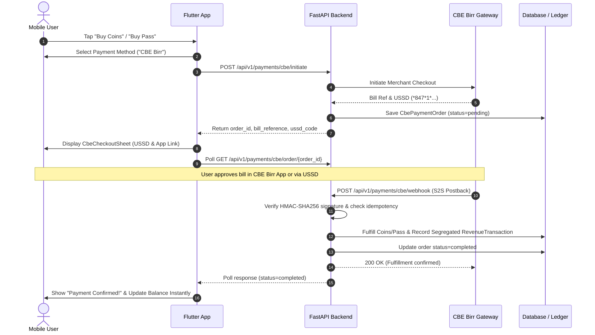

# ADWA SHORT — Commercial Bank of Ethiopia (CBE / CBE Birr) Integration Guide

This guide details the automated payment initiation service, Server-to-Server (S2S) webhook postbacks, cryptographic signature verification, idempotency protection, revenue ledger segregation, and Flutter client checkout for the **Commercial Bank of Ethiopia (CBE / CBE Birr)** integration in the ADWA SHORT platform.

---

## 1. System Overview

The CBE / CBE Birr integration enables automated payments across:
- **FastAPI Backend**:
  - `POST /api/v1/payments/cbe/initiate`: Creates a pending payment order and returns CBE bill references, checkout URLs, and USSD dial strings.
  - `POST /api/v1/payments/cbe/webhook`: Secure S2S callback endpoint that cryptographically verifies HMAC-SHA256 signatures and fulfills orders automatically without receipt uploads.
  - `GET /api/v1/payments/cbe/order/{order_id}`: Real-time order status check polled by mobile clients.
  - `POST /api/v1/payments/cbe/simulate-payment/{order_id}`: Development/test mode mock confirmation tool.
  - `GET /api/v1/payments/cbe/admin/orders`: Super Admin audit endpoint for reviewing all CBE payment transactions.
- **Flutter Mobile Client**:
  - `CbeCheckoutSheet`: Sleek modal sheet styled in Black, Blood Red, and White.
  - Offers USSD Quick Dial (`*847*1*847291*...#`) and Web/App checkout links.
  - Real-time polling listener that automatically updates user Coin balances or activates Time Passes / Subscriptions the moment CBE confirms payment.
- **React Admin Dashboard**:
  - Transaction monitoring filters under `/revenue/transactions` with dedicated CBE source types.

---

## 2. Environment Variables (.env)

```env
# ==============================================================================
# COMMERCIAL BANK OF ETHIOPIA (CBE / CBE BIRR) GATEWAY CONFIGURATION
# ==============================================================================
CBE_ENABLED=true
CBE_TEST_MODE=true
CBE_API_BASE_URL=https://api.cbe.com.et
CBE_MERCHANT_ID=CBE_MERCHANT_ADWA_SHORT
CBE_TILL_NUMBER=847291
CBE_API_KEY=cbe_api_key_adwashort_live
CBE_SECRET_KEY=cbe_secret_key_change_in_production
CBE_WEBHOOK_SECRET=cbe_webhook_signing_secret_prod
CBE_WEBHOOK_URL=https://api.adwashort.com/api/v1/payments/cbe/webhook
CBE_RETURN_URL=adwashort://payment-complete
CBE_CREATOR_RESERVE_SPLIT_PCT=50.0

# Platform Treasury (Commercial Bank of Ethiopia)
CBE_TREASURY_ACCOUNT_NUMBER=1000293847561
CBE_TREASURY_ACCOUNT_NAME=ADWA SHORT ENTERTAINMENT PLATFORM
CBE_TREASURY_BANK_NAME=Commercial Bank of Ethiopia (CBE)
CBE_TREASURY_BRANCH=Finfine Branch / Head Office
```

---

## 3. Cryptographic Signature & Webhook Verification

Every S2S notification delivered to `/api/v1/payments/cbe/webhook` must include a valid cryptographic signature or secret token:
- **Header**: `X-CBE-Signature`, `X-Signature`, or `X-CBE-Secret`
- **Canonical Calculation**:
  ```python
  canonical = f"merchant_id={merchant_id}&order_id={order_id}&amount={amount:.2f}&timestamp={timestamp}"
  signature = hmac.new(CBE_WEBHOOK_SECRET.encode(), canonical.encode(), hashlib.sha256).hexdigest()
  ```
- **Timing-Safe Comparison**: Evaluated using `hmac.compare_digest` to prevent timing attacks.

---

## 4. Idempotency & Financial Ledger Segregation

1. **Idempotency Guarantee**:
   - Every order has a unique `order_id` (e.g. `CBE-ORD-...`) and unique `cbe_transaction_id`.
   - If an already completed order or transaction hash is received again, the backend responds with `200 OK` (`"status": "already_processed"`) and avoids duplicate balance credits, pass activations, or ledger duplicates.
2. **Revenue Ledger Segregation & Platform Treasury**:
   - All client checkouts and platform earnings land in the central **Adwa Short Platform Treasury** (`1000293847561`).
   - **Unified Watch-Time Attribution Model**: Both **Time Passes** and **Subscriptions** (monthly/yearly passes) operate on an identical prorated watch-time attribution split:
     - **Per-Second Rate Calculation**:
       $$\text{rate\_per\_second} = \frac{\text{package\_price}}{\text{total\_duration\_seconds}}$$
     - **Attributed Episode Revenue**:
       $$\text{gross\_attributed\_revenue} = \text{watch\_time\_seconds} \times \text{rate\_per\_second}$$
     - **Creator Share**: Each creator's net payable balance (`CreatorProfile.net_payable_birr`) is credited by:
       $$\text{creator\_share} = \text{gross\_attributed\_revenue} \times \frac{\text{split\_pct}}{100.0}$$
     - **Platform Share**: $\text{gross\_attributed\_revenue} - \text{creator\_share}$ remains in Platform Treasury.
     - **Unconsumed Time / Idle Duration**: Any expired pass or subscription duration (or idle time) where no watch-time was recorded remains **100% with the Adwa Short Platform Treasury** (`Account: 1000293847561`) with `creator_share_birr = 0.0` and `platform_share_birr = unconsumed_amount`.
   - **Coin Spend Splits**: Per-episode coin unlock purchases deduct coins and credit creator net payable balance based on the configured creator revenue split ratio.
   - **Ad Revenues**: 100% platform-owned retained revenue credited to the Platform Treasury (`1000293847561`).

3. **Creator Payout Disbursement (Treasury to Creator CBE Accounts)**:
   - Disbursements are executed via CBE B2C transfers from the Central Platform Treasury to creators' verified Commercial Bank of Ethiopia (CBE) accounts.
   - Payout transactions track `cbe_transaction_id`, `bank_account_number`, `bank_account_name`, and `treasury_account_number`.
   - Super Admins can audit payouts and trigger/retry disbursements via `POST /admin/revenue/payouts/{id}/disburse`.

---

## 5. Mobile Checkout Flow



---

## 6. Testing & Verification

### A. Run Backend CBE Pytest Suite
```bash
cd adwa-short-backend
.\venv\Scripts\pytest tests/test_cbe_payment.py -v
```

### B. Run Flutter Mobile Checkout Suite
```bash
cd adwa-short-mobile/adwa_short
flutter test test/cbe_payment_test.dart
```

### C. Manual cURL Testing

#### 1. Initiate Checkout:
```bash
curl -X POST "http://localhost:8000/api/v1/payments/cbe/initiate" \
  -H "Content-Type: application/json" \
  -H "Authorization: Bearer <USER_JWT>" \
  -d '{
    "item_type": "coins",
    "item_id": 1,
    "phone": "+251911223344"
  }'
```

#### 2. Trigger Instant Simulation:
```bash
curl -X POST "http://localhost:8000/api/v1/payments/cbe/simulate-payment/CBE-ORD-XXXXXX"
```
